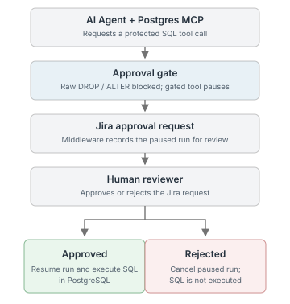

# Inventory Console — MCP approval demo

Inventory Console is a demo product dashboard backed by PostgreSQL and a chat-based DBA agent. It shows how selected schema-changing tool calls can be paused for human review in Jira before the agent resumes. The approval flow is an engineering demonstration, not a production security boundary.

## Why this project exists

An agent connected to a database can issue consequential tool calls, and model instructions alone are not reliable enforcement. This project combines a tool hook, Agno's confirmation pause, and an external Jira decision so a reviewer can inspect a proposed operation before it runs.

## How it works

The React/Vite UI reads the product catalog through a Node/Express API. Chat requests go separately to Agno AgentOS, whose agent connects to PostgreSQL through the <code>postgres-mcp</code> server.

For <code>DROP TABLE</code> or <code>ALTER TABLE</code>, the hook blocks attempts through MCP's <code>execute_sql</code> tool and tells the agent to use the custom <code>run_admin_sql</code> tool. Agno pauses that confirmation-required tool call. Middleware creates a Jira issue and stores the run-to-issue mapping; after a reviewer changes the Jira status, the UI checks it and either resumes or cancels the run.

## Key capabilities

- A React inventory dashboard with seeded products and a chat interface.
- PostgreSQL MCP tools for the agent to query and update catalog data.
- A hook that blocks <code>DROP TABLE</code> and <code>ALTER TABLE</code> when attempted through <code>execute_sql</code>.
- A separate Agno confirmation-required tool, Jira issue creation/status checks, and approve/resume or reject/cancel routes.
- Run, session, tool, and argument details recorded in Jira fields and a PostgreSQL <code>run_approvals</code> mapping table.

## Quick start

This demo requires Node.js 18.11+, Python 3.10+, PostgreSQL, the <code>postgres-mcp</code> CLI on <code>PATH</code>, an NVIDIA API key, and a Jira Cloud project configured with the issue type and nine custom fields in [agent-service/.env.example](agent-service/.env.example). See [docs/02-setup.md](docs/02-setup.md) for complete configuration instructions.

1. Initialize the product catalog: <code>psql "$DATABASE_URL" -f db/init.sql</code>.
2. Create the approval mapping table; it is required at runtime but is **not** created by <code>db/init.sql</code>:

   ~~~sql
   CREATE TABLE run_approvals (
     run_id VARCHAR PRIMARY KEY,
     jira_issue_key VARCHAR NOT NULL,
     requirement_json JSONB NOT NULL
   );
   ~~~

3. Configure <code>agent-service/.env</code>, install its listed packages plus the currently undeclared imports, and start the agent:

   ~~~bash
   cd agent-service
   pip install -r requirements.txt
   pip install jira psycopg2-binary certifi truststore httpx
   python agent.py
   ~~~

4. In separate terminals, configure <code>backend/.env</code> with <code>DATABASE_URL</code>, then run <code>cd backend && npm install && npm run dev</code>; start the UI with <code>cd frontend && npm install && npm run dev</code>.
5. Open <code>http://localhost:5173</code>. The default chat adapter targets the Agno service on <code>http://localhost:7790</code>.

## Example workflow

Against a **throwaway database**, ask the chat agent to <code>DROP TABLE products</code>:

1. The hook blocks a direct MCP <code>execute_sql</code> attempt. The agent is instructed to route the statement through <code>run_admin_sql</code>, which pauses before execution.
2. Jira receives an approval issue. A reviewer transitions it to an approved or rejected status.
3. In the chat UI, check the approval status. If approved, click again to resume the run and execute the SQL. If rejected/blocked, the app calls the cancel route; the SQL is not run.

The Jira status mapping (<code>to do</code>/<code>in progress</code>, <code>approved</code>/<code>done</code>, <code>rejected</code>/<code>blocked</code>) is hard-coded in <code>agent-service/agent.py</code> and must match the Jira workflow. The app does not make the Jira decision for the reviewer.

## Technical decisions and limitations

The raw MCP tool hook and the confirmation-required custom tool are separate because the MCP tool does not use Agno's per-tool confirmation flag. Jira holds the human decision; PostgreSQL stores the mapping needed to find the issue when a paused run resumes.

- The hook only pattern-matches <code>DROP TABLE</code> and <code>ALTER TABLE</code> on the tool named <code>execute_sql</code>; it does not cover every DDL form or replace database permissions. <code>postgres-mcp</code> is configured with <code>--access-mode=unrestricted</code>.
- <code>run_admin_sql</code> accepts arbitrary SQL once approved; it does not validate that the statement is only <code>DROP</code> or <code>ALTER</code>.
- <code>run_approvals</code> is not provisioned by the checked-in SQL. <code>requirements.txt</code> also omits imports needed by the agent; the install commands above work around that gap.
- The standard UI sends <code>stream=false</code>. The middleware's event-stream branch currently contains placeholder Jira-creation code, so streaming approval creation is not demonstrated.
- Jira status names are mapped in code, not configuration. The setup needs a real Jira instance, custom fields, model credentials, and a reachable database; this is not a one-command or production deployment.

The repository also contains deeper notes on [architecture](docs/01-architecture.md), [data model](docs/03-data-model.md), [agent service](docs/05-agent-service.md), [approval flow](docs/06-hitl-approval-workflow.md), and [known gaps](docs/08-known-gaps.md).